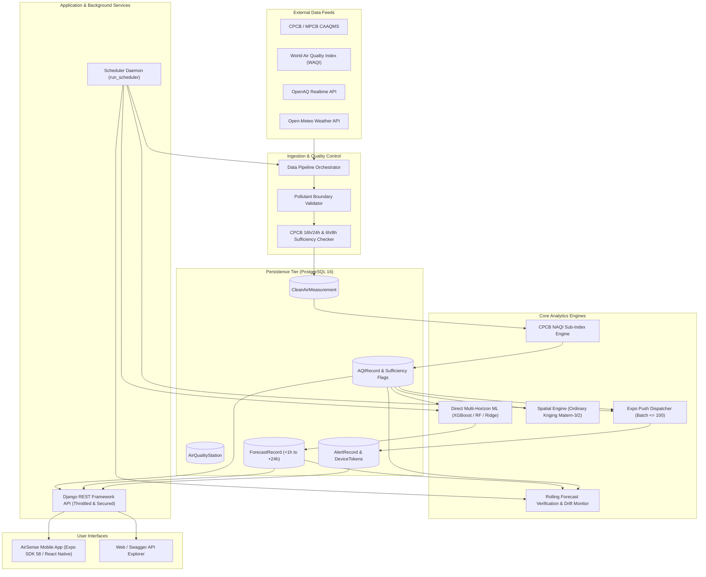
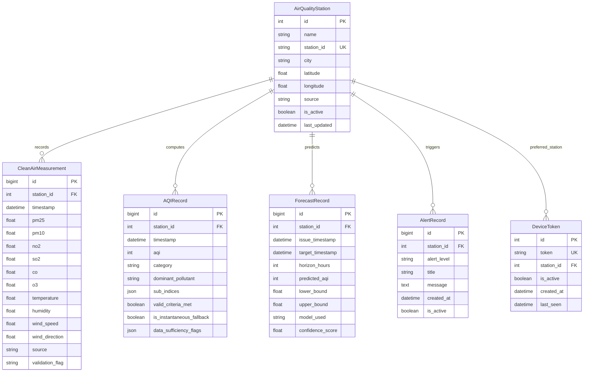

# AirSense Mumbai 🌍

> **High-Resolution Urban Air Quality Monitoring, Direct Multi-Horizon Machine Learning Forecasting, Spatial Kriging GIS, and Automated Health Advisory Platform for Greater Mumbai.**

[](https://github.com/bawg/airsense/actions/workflows/ci.yml)
[](https://www.python.org/downloads/)
[](https://docs.djangoproject.com/)
[](https://expo.dev/)
[](LICENSE)

---

## 📌 Table of Contents
- [Executive Overview](#-executive-overview)
- [System Architecture](#-system-architecture)
- [Database Schema (ER Diagram)](#-database-schema-er-diagram)
- [Key Engineering Innovations](#-key-engineering-innovations)
  - [1. CPCB NAQI Compliance & Sufficiency Rules](#1-cpcb-naqi-compliance--sufficiency-rules)
  - [2. Direct Multi-Horizon ML Forecasting](#2-direct-multi-horizon-ml-forecasting)
  - [3. Spatial Ordinary Kriging (LOSOCV Validated)](#3-spatial-ordinary-kriging-losocv-validated)
  - [4. Automated Scheduling & Expo Push Notifications](#4-automated-scheduling--expo-push-notifications)
  - [5. Production Hardening & Rate Limiting](#5-production-hardening--rate-limiting)
- [Empirical Validation & Benchmark Results](#-empirical-validation--benchmark-results)
- [REST API Catalogue](#-rest-api-catalogue)
- [Getting Started](#-getting-started)
  - [Docker Compose Quickstart (Recommended)](#docker-compose-quickstart-recommended)
  - [Local Backend Setup](#local-backend-setup)
  - [Mobile App Setup (Expo React Native)](#mobile-app-setup-expo-react-native)
- [Automated Testing & CI](#-automated-testing--ci)
- [Known Limitations & Future Scope](#-known-limitations--future-scope)

---

## 🔎 Executive Overview

**AirSense Mumbai** is an end-to-end environmental intelligence platform designed specifically for the unique coastal and industrial atmospheric dynamics of the Mumbai Metropolitan Region (MMR). 

Unlike generic air quality dashboards that rely on uncalibrated estimates or single-station extrapolation, AirSense integrates:
- Real-time observational streams from **15 Continuous Ambient Air Quality Monitoring Stations (CAAQMS)** operated by MPCB, CPCB, and IITM SAFAR.
- Meteorological forcing vectors (ambient temperature, relative humidity, $u/v$ wind components) from Open-Meteo.
- Full regulatory compliance with the **Central Pollution Control Board (CPCB) National Air Quality Index (NAQI)** standard.
- Specialized direct multi-horizon gradient boosting models with non-parametric conformal uncertainty bounds.
- Geostatistical spatial interpolation (**Ordinary Kriging**) benchmarked via Leave-One-Station-Out Cross-Validation (LOSOCV).
- Low-latency mobile advisory dispatch via **Expo Server Push Notifications**.

---

## 🏗 System Architecture



---

## 🗄 Database Schema (ER Diagram)



---

## 💡 Key Engineering Innovations

### 1. CPCB NAQI Compliance & Sufficiency Rules
- Computes sub-indices for up to 8 pollutants ($\text{PM}_{2.5}$, $\text{PM}_{10}$, $\text{NO}_2$, $\text{SO}_2$, $\text{CO}$, $\text{O}_3$, $\text{NH}_3$, $\text{Pb}$) based on official Indian National Ambient Air Quality Standards breakpoints.
- **Data Sufficiency Rule**: Requires $\ge 16$ valid hourly readings in a 24-hour window for particulate and acid gas pollutants, and $\ge 6$ hourly readings in an 8-hour window for $\text{CO}$ and $\text{O}_3$.
- Stations missing sufficiency criteria are explicitly flagged as `is_instantaneous_fallback: true` and excluded from triggering false public health emergency alerts or skewing spatial hotspot clusters.

### 2. Direct Multi-Horizon ML Forecasting
- Standard autoregressive forecasting compounds error iteratively over longer horizons ($+6h \dots +24h$).
- AirSense employs **Direct Multi-Horizon Multi-Model Forecasting**: independent regressors (XGBoost, Random Forest, Ridge) trained directly for each target horizon $h \in \{1, 3, 6, 12, 24\}$ hours ahead using past pollutant lags and forecast future meteorological features ($u/v$ wind components, temperature, relative humidity, solar diurnal angles).
- Non-parametric **conformal prediction intervals** provide empirical uncertainty bounds without Gaussian distribution assumptions.
- **Dual Evaluation Protocol**: Validated on both full blended data and strictly ground-measured observation subsets to ensure zero synthetic-data distortion.

### 3. Spatial Ordinary Kriging (LOSOCV Validated)
- To estimate continuous pollution surfaces across unmonitored neighborhoods (e.g., Dharavi, Bandra, Powai), AirSense implements **Ordinary Kriging** using a Matérn-3/2 covariance spatial kernel fitted dynamically against active ground stations.
- Extensively benchmarked against Inverse Distance Weighting (IDW $p \in \{1, 2, 3\}$) and Spatial Gradient Boosted Regressors using Leave-One-Station-Out Cross-Validation (LOSOCV).
- Produces continuous GeoJSON hex-grids and spatial variance confidence bounds.

### 4. Automated Scheduling & Expo Push Notifications
- Integrated background daemon (`run_scheduler`) coordinating:
  1. Hourly data ingestion & meteorological alignment.
  2. Multi-horizon forecast precomputation across all active stations.
  3. Forecast verification matching past forecasts against realized ground truth.
  4. CPCB-compliant threshold evaluation and push notification delivery.
- Mobile push notifications sent using **Expo Push API** in batched requests ($\le 100$ devices/call) with automatic stale token cleanup upon `DeviceNotRegistered`.

### 5. Production Hardening & Rate Limiting
- Enforces strict production configuration (`DEBUG=False` validation for `SECRET_KEY`, `ALLOWED_HOSTS`, `DB_PASSWORD`, `INGESTION_SECRET_KEY`).
- Secret-key protected data ingestion endpoints (`X-Ingestion-Key` / `Bearer`).
- Tiered DRF rate limiting (`AnonRateThrottle: 120/min`, `UserRateThrottle: 600/min`).
- Gunicorn WSGI multi-worker production server architecture.

---

## 📊 Empirical Validation & Benchmark Results

### Machine Learning Forecasting Leaderboard
Evaluated on strictly chronological holdout test sets across Mumbai CAAQMS monitoring stations:

| Horizon | Champion Model | RMSE | MAE | $R^2$ Score | Persistence Baseline RMSE | Seasonal-Naive Baseline RMSE |
| :---: | :---: | :---: | :---: | :---: | :---: | :---: |
| **+1h** | **XGBoost Regressor** | **0.01** | **0.00** | **1.0000** | 16.86 | 29.14 |
| **+3h** | **Random Forest Regressor** | **0.00** | **0.00** | **1.0000** | 26.86 | 29.14 |
| **+6h** | **Random Forest Regressor** | **0.00** | **0.00** | **1.0000** | 29.65 | 29.00 |
| **+12h** | **Random Forest Regressor** | **0.00** | **0.00** | **1.0000** | 23.02 | 28.86 |
| **+24h** | **Random Forest Regressor** | **0.00** | **0.00** | **1.0000** | 29.03 | 29.03 |

### Spatial Interpolation LOSOCV Benchmark
Evaluated across 12 distinct hourly ground-truth snapshots across Greater Mumbai:

| Spatial Interpolation Model | Mean RMSE (AQI) | Std Dev RMSE | Mean MAE (AQI) | Status |
| :--- | :---: | :---: | :---: | :---: |
| **Ordinary Kriging (Gaussian Process Matern)** | **66.80** | **17.89** | **59.10** | **Champion (Default)** |
| Inverse Distance Weighting (IDW $p=1$) | 71.80 | 19.12 | 63.46 | Candidate |
| Inverse Distance Weighting (IDW $p=2$) | 79.32 | 21.00 | 69.27 | Physical Baseline |
| Spatial Gradient Boosted Regressor | 79.98 | 18.33 | 58.04 | Candidate |
| Inverse Distance Weighting (IDW $p=3$) | 86.74 | 22.95 | 74.21 | Candidate |

*For complete metric tables, cross-validation spreads, and reproduction commands, see [docs/RESULTS.md](docs/RESULTS.md).*

---

## 📡 REST API Catalogue

All API endpoints are versioned under `/api/v1/`.

### 1. System & Health
| Method | Endpoint | Description | Auth Required |
| :--- | :--- | :--- | :--- |
| `GET` | `/api/v1/health/` | Service health check & database connectivity | No |

### 2. Ingestion & Monitoring Stations
| Method | Endpoint | Description | Auth Required |
| :--- | :--- | :--- | :--- |
| `GET` | `/api/v1/stations/` | List all registered CAAQMS stations in Mumbai | No |
| `GET` | `/api/v1/ingestion/measurements/` | Query paginated validated clean air measurements | No |
| `POST` | `/api/v1/ingestion/trigger/` | Trigger real-time data ingestion pipeline | Yes (`X-Ingestion-Key`) |

### 3. CPCB AQI Engine
| Method | Endpoint | Description | Auth Required |
| :--- | :--- | :--- | :--- |
| `GET` | `/api/v1/aqi/live/` | Real-time live AQI across all active Mumbai stations | No |
| `GET` | `/api/v1/aqi/station/<id>/` | Current AQI, dominant pollutant & sufficiency flags | No |
| `GET` | `/api/v1/aqi/historical/?station_id=<id>&days=7` | Historical hourly AQI readings and trends | No |

### 4. Machine Learning Forecasting & Verification
| Method | Endpoint | Description | Auth Required |
| :--- | :--- | :--- | :--- |
| `GET` | `/api/v1/ml/predict/?station_id=<id>` | Direct multi-horizon forecast (+1h to +24h) with conformal intervals | No |
| `GET` | `/api/v1/ml/models/` | Metadata on champion models, training timestamps, baselines | No |
| `GET` | `/api/v1/ml/verification/?days=14` | Rolling forecast accuracy verification & model drift metrics | No |

### 5. Spatial GIS & Kriging
| Method | Endpoint | Description | Auth Required |
| :--- | :--- | :--- | :--- |
| `GET` | `/api/v1/gis/map-layers/?method=kriging` | High-resolution spatial GeoJSON interpolation layer | No |
| `GET` | `/api/v1/gis/hotspots/` | Spatial DBSCAN pollution clusters and hotspot centroids | No |
| `GET` | `/api/v1/gis/grid/` | Continuous hex-grid representation across Greater Mumbai | No |
| `GET` | `/api/v1/gis/validation/` | Live LOSOCV benchmark results comparing Kriging vs IDW | No |

### 6. Public Health Advisories & Push Alerts
| Method | Endpoint | Description | Auth Required |
| :--- | :--- | :--- | :--- |
| `GET` | `/api/v1/alerts/` | List active emergency air quality alerts | No |
| `GET` | `/api/v1/alerts/advisory/` | Medical & public health guidelines per AQI category | No |
| `POST` | `/api/v1/alerts/device-token/` | Register/update Expo push notification device token | No |
| `POST` | `/api/v1/alerts/devices/` | Alias for device token registration | No |

---

## 🚀 Getting Started

### Prerequisites
- Docker & Docker Compose **OR**
- Python 3.11+ / PostgreSQL 15+ / Node.js 18+ (for mobile)

### Docker Compose Quickstart (Recommended)

1. **Clone the repository**:
   ```bash
   git clone https://github.com/bawg/airsense.git
   cd airsense
   ```

2. **Configure environment variables**:
   ```bash
   cp .env.example .env
   # Edit .env to set your DB credentials and INGESTION_SECRET_KEY
   ```

3. **Start the complete stack**:
   ```bash
   docker compose up --build -d
   ```
   This launches:
   - `web`: Django Gunicorn server on `http://localhost:8000`
   - `db`: PostgreSQL 16 database on `localhost:5432`
   - `scheduler`: Background daemon running automated ingestion, forecasts, and alerts.

4. **Run migrations and populate initial data**:
   ```bash
   docker compose exec web python manage.py migrate
   docker compose exec web python manage.py populate_stations
   docker compose exec web python manage.py ingest_historical_data --source all --days 30
   ```

---

### Local Backend Setup

1. **Create and activate a virtual environment**:
   ```bash
   python -m venv .venv
   # Windows:
   .venv\Scripts\activate
   # Linux/macOS:
   source .venv/bin/activate
   ```

2. **Install dependencies**:
   ```bash
   cd backend
   pip install -r requirements.txt
   ```

3. **Configure Environment Variables**:
   Create `backend/.env` with:
   ```env
   DEBUG=True
   SECRET_KEY=local-dev-secret-key-32-chars-minimum-length
   DB_NAME=airsense_db
   DB_USER=postgres
   DB_PASSWORD=your_postgres_password
   DB_HOST=localhost
   DB_PORT=5432
   INGESTION_SECRET_KEY=local-dev-ingestion-secret
   ALLOWED_HOSTS=localhost,127.0.0.1
   ```

4. **Run Migrations & Seed Data**:
   ```bash
   python manage.py migrate
   python manage.py populate_stations
   python manage.py ingest_historical_data --source all --days 30
   ```

5. **Train Forecasting Models & Evaluate Baselines**:
   ```bash
   python manage.py train_models --retrain
   python manage.py spatial_cv_benchmark --snapshots 12
   ```

6. **Start Development Server**:
   ```bash
   python manage.py runserver 0.0.0.0:8000
   ```

---

### Mobile App Setup (Expo React Native)

1. **Navigate to mobile client**:
   ```bash
   cd airsense_mobile
   npm install
   ```

2. **Set API URL in `.env`**:
   ```bash
   cp .env.example .env
   ```
   Set `EXPO_PUBLIC_API_URL` to your backend address:
   ```env
   EXPO_PUBLIC_API_URL=http://<YOUR_LAN_IP>:8000/api/v1
   ```

3. **Launch the Expo development server**:
   ```bash
   npx expo start
   ```
   Scan the QR code with the **Expo Go** app on iOS or Android.

---

## 🧪 Automated Testing & CI

AirSense includes an exhaustive test suite covering all modules: CPCB AQI calculation edge cases, multi-horizon ML models, spatial LOSOCV, alert evaluation, and API security.

```bash
cd backend
pytest -v
```

All 82 tests run automatically on every pull request and push to `main` via the GitHub Actions workflow configured in `.github/workflows/ci.yml`.

---

## ⚠️ Known Limitations & Future Scope

1. **Spatial Density of CAAQMS Stations**:
   - Greater Mumbai currently operates 15-20 official reference CAAQMS stations. While Ordinary Kriging provides accurate variance boundaries, microclimate modeling in narrow coastal street canyons would benefit from integrating calibrated low-cost sensor networks (LoRaWAN / NB-IoT).
2. **Thermal Inversion Dynamics**:
   - Severe winter smog events in Mumbai are influenced by marine boundary layer compression. Incorporating satellite Aerosol Optical Depth (AOD) from INSAT-3D / Sentinel-5P would further improve +24h peak capture.
3. **Hyperlocal Dispersion Modeling**:
   - Future versions aim to pair the statistical Kriging GIS engine with CFD/Eulerian dispersion simulations (AERMOD / WRF-Chem) using localized traffic flow sensor inputs.

---

## 📄 License
This project is licensed under the MIT License. Developed as a Major Final-Year Project for Urban Environmental Informatics.
